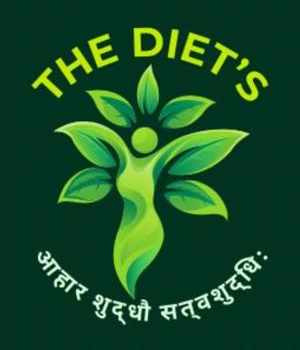
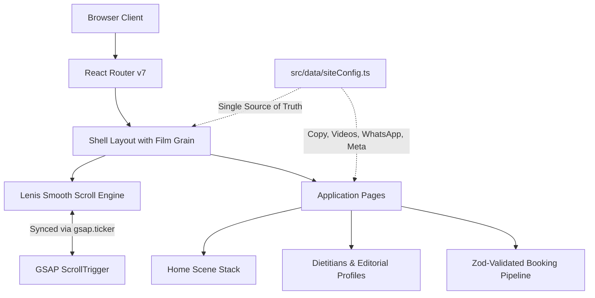

<div align="center">

  

  # The Diet's
  ### आहार शुद्धौ सत्त्वशुद्धिः
  *“When food and nourishment are pure, the inner essence becomes serene and clear.”*

  <p align="center">
    A high-performance, editorial-grade web application for personalized video nutrition consultations, founded by <strong>Dt. Radha Mishra</strong> and <strong>Dt. Surbhi Kumari</strong>.
  </p>

  <p align="center">
    <a href="#-architecture--tech-stack"></a>
    <a href="#-architecture--tech-stack"></a>
    <a href="#-architecture--tech-stack"></a>
    <a href="#-architecture--tech-stack"></a>
    <a href="#-motion--scroll-architecture"></a>
    <a href="#-motion--scroll-architecture"></a>
  </p>
</div>

---

## ✦ Table of Contents

- [Executive Overview](#-executive-overview)
- [Design System & Palette](#-design-system--palette)
- [Architecture & Tech Stack](#-architecture--tech-stack)
- [Motion & Smooth-Scroll Engine](#-motion--smooth-scroll-engine)
- [Directory Structure](#-directory-structure)
- [Single Source of Truth (`siteConfig`)](#-single-source-of-truth-siteconfig)
- [Getting Started](#-getting-started)
- [Available Scripts](#-available-scripts)
- [Performance & Accessibility Standards](#-performance--accessibility-standards)
- [License & Credits](#-license--credits)

---

## 🌿 Executive Overview

**The Diet's** reimagines clinical and lifestyle nutrition care. Instead of rigid diet templates and restrictive rules, the platform emphasizes mindful, sustainable habits rooted in home-cooked meals, circadian rhythm, and unhurried 1-on-1 video consultations.

- **Private Consultations**: Bespoke booking pipelines with direct WhatsApp triage.
- **Editorial Experience**: Cinematic typography pairing `Fraunces` (variable optical-size serif) with `DM Sans`.
- **Zero-Jank Motion**: High-frequency RAF synchronization uniting Lenis smooth scroll with GSAP ScrollTrigger.
- **Accessibility by Design**: Native `prefers-reduced-motion` guards across all timelines and transitions.

---

## 🎨 Design System & Palette

The visual language draws inspiration from classical botanical apothecary journals and calming organic earth tones.

### Color Tokens

| Token | Hex | Role & Application | Swatch |
| :--- | :--- | :--- | :---: |
| `green.obsidian` | `#12261F` | Deep background canvas, modal backdrops, text dark | `⬛` |
| `green.deep` | `#1F3D33` | Primary brand ground, hero sections, card containers | `🟩` |
| `cream` / `paper` | `#F6F3EC` | Editorial text highlights, clean parchment backdrops | `⬜` |
| `sage` | `#E7ECE4` | Secondary text, subtle borders, soft card highlights | `◽` |
| `gold` | `#B88A4A` | Accents, badges, editorial flourishes, focal CTAs | `🟨` |

### Typography Scale

```css
/* Display / Headline Typography */
font-family: 'Fraunces', Georgia, serif;
font-optical-sizing: auto;
font-weight: 300 | 400;

/* Body / Interface Typography */
font-family: 'DM Sans', -apple-system, BlinkMacSystemFont, sans-serif;
font-weight: 400 | 500;
```

---

## ⚡ Architecture & Tech Stack



- **Frontend Core**: [React 18](https://react.dev/) with functional components, custom hooks, and concurrent hydration patterns.
- **Typing & Validation**: [TypeScript 5.5](https://www.typescriptlang.org/) strict mode + [Zod v4](https://zod.dev/) runtime schema validation.
- **Form Management**: [React Hook Form](https://react-hook-form.com/) with `@hookform/resolvers/zod` for zero-re-render form state.
- **Routing**: [React Router v7](https://reactrouter.com/) client-side navigation with route transition hooks.
- **Styling**: [Tailwind CSS 3.4](https://tailwindcss.com/) extended with glassmorphism utilities (`glass-header`, `glass-pill`, backdrop blur filters).
- **Icons**: [Lucide React](https://lucide.dev/) for crisp, scalable SVG iconography.

---

## 🚀 Motion & Smooth-Scroll Engine

The motion experience combines **Lenis** (momentum scrolling) with **GSAP** (pinning, timeline sequencing, and scrub animations).

### Engine Synchronization Hook (`useSmoothScroll`)

```typescript
// Pinned scenes update cleanly without desyncing or scroll jumps
const lenis = new Lenis({
  lerp: 0.08,
  smoothWheel: true,
  wheelMultiplier: 1,
  touchMultiplier: 1.5,
});

// Bind Lenis scroll events to GSAP ScrollTrigger
lenis.on('scroll', ScrollTrigger.update);

// Direct RAF binding with zero lag smoothing
const tickerFn = (time: number) => {
  lenis.raf(time * 1000);
};
gsap.ticker.add(tickerFn);
gsap.ticker.lagSmoothing(0);
```

> [!TIP]
> If a user has `prefers-reduced-motion` enabled in their OS, `useSmoothScroll` completely skips ticker registration, allowing native instant scrolling.

---

## 📂 Directory Structure

```text
Thedeits/
├── public/
│   ├── images/              # High-res portraits (Radha Mishra, Surbhi Kumari, duos)
│   ├── favicon.png          # Circular brand mark
│   ├── hero-bg.png          # High-resolution desk editorial hero visual
│   ├── logo.png             # The Diet's Sanskrit typography logo mark
│   ├── robots.txt           # Crawler instructions
│   └── sitemap.xml          # Canonical XML index
├── src/
│   ├── components/
│   │   ├── Accordion.tsx         # Accessible collapsible FAQ & program cards
│   │   ├── EditorialPortrait.tsx # Profile portrait with gradient ground
│   │   ├── Footer.tsx            # Full-bleed brand footer & quick links
│   │   ├── Header.tsx            # Floating pill navbar with responsive menu
│   │   ├── PageHero.tsx          # Reusable hero banner for secondary routes
│   │   ├── Silhouette.tsx        # Ambient backdrop silhouette effects
│   │   └── VideoBackground.tsx   # Canvas video player with live-fallback
│   ├── data/
│   │   └── siteConfig.ts         # Single Source of Truth for brand, copy & bio data
│   ├── hooks/
│   │   ├── useRouteTransition.ts # Page change fade & smooth scroll resets
│   │   ├── useSeo.ts             # Dynamic document titles & OpenGraph tags
│   │   └── useSmoothScroll.ts    # GSAP Ticker + Lenis bridge
│   ├── pages/
│   │   ├── BookPage.tsx          # Multi-step consultation booking flow
│   │   ├── DietitiansPage.tsx    # Editorial team dossiers and credentials
│   │   ├── FaqPage.tsx           # Categorized inquiries & guidelines
│   │   ├── HomePage.tsx          # Sequential storytelling landing scene
│   │   ├── HowItWorksPage.tsx    # 3-phase journey from intake to sustainability
│   │   ├── NotFoundPage.tsx      # Graceful 404 handler
│   │   └── ProgramsPage.tsx      # Clarity Session, 4-Week Reset, 12-Week Care
│   ├── scenes/
│   │   ├── CloseScene.tsx        # High-impact concluding CTA section
│   │   ├── Hero.tsx              # Split editorial hero with responsive clamp
│   │   ├── HowItWorks.tsx        # Interactive process breakdown
│   │   ├── MeetDietitians.tsx    # Featured dietitian spotlight scene
│   │   ├── NoiseScene.tsx        # Subtle grain / texture overlays
│   │   ├── PlanScene.tsx         # Program roadmap cards
│   │   └── WhatWeHelp.tsx        # Focus pillars (Gut, Hormonal, Energy, Routine)
│   ├── App.tsx                   # Top-level shell with grain and route definitions
│   ├── index.css                 # Custom font imports, glass classes, tokens
│   └── main.tsx                  # Vite app entry point
├── index.html                    # HTML5 shell, OpenGraph tags, font preconnects
├── tailwind.config.js            # Custom color palette and font declarations
├── tsconfig.json                 # TypeScript project configuration
└── vite.config.ts                # Vite config with '@' path alias resolution
```

---

## 📜 Single Source of Truth (`siteConfig`)

All phone numbers, WhatsApp routing, doctor biographies, program pricing, and copy are centralized in [`src/data/siteConfig.ts`](src/data/siteConfig.ts).

To update contact information or consultation rates, modify only this file:

```typescript
export const siteConfig = {
  brand: {
    name: 'The Diets',
    tagline: 'Nutrition guidance that fits your life.',
    whatsappUrl: 'https://wa.me/91...',
    email: 'care@thediets.in',
  },
  dietitians: [
    {
      slug: 'radha',
      name: 'Radha Mishra',
      title: 'Lead Clinical & Lifestyle Dietitian',
      qualifications: ['M.Sc. Clinical Nutrition', 'Certified Diabetes Educator'],
      ...
    },
    ...
  ],
  ...
};
```

---

## 🛠 Getting Started

### Prerequisites

- **Node.js**: `v18.0.0` or higher
- **Package Manager**: `npm` (v9+) or `pnpm`

### Installation

1. **Clone the repository**:
   ```bash
   git clone https://github.com/Naveenmehta121/Thedeits.git
   cd Thedeits
   ```

2. **Install dependencies**:
   ```bash
   npm install
   ```

3. **Start the local development server**:
   ```bash
   npm run dev
   ```

4. **Open in browser**:
   Navigate to [http://localhost:5173/](http://localhost:5173/) or the port indicated in your terminal.

---

## ⚙️ Available Scripts

| Command | Action |
| :--- | :--- |
| `npm run dev` | Starts Vite HMR development server with fast refresh |
| `npm run build` | Compiles TypeScript and bundles production assets to `/dist` |
| `npm run preview` | Locally serves the production build for smoke testing |
| `npm run typecheck` | Runs `tsc --noEmit` across all app sources |
| `npm run lint` | Analyzes code for ESLint rule violations |

---

## 💎 Performance & Accessibility Standards

- **Core Web Vitals**: Images are served with explicit dimensions and `loading="eager"` / `decoding="async"` on LCP hero assets.
- **Fluid Typography**: Dynamic headings use CSS `clamp()` (`clamp(2.5rem, 5.2vw, 4.25rem)`) to eliminate layout shift across ultra-wide and mobile viewports.
- **Motion Reduction**: `window.matchMedia('(prefers-reduced-motion: reduce)')` is strictly respected in all GSAP timelines and Lenis loops.
- **Film Grain Optimization**: Custom SVG turbulence grain filter applied via fixed pseudo-element with `pointer-events-none` to eliminate paint thrashing.

---

## 📄 License & Credits

- **Copyright**: © 2026 **The Diet's** (Founded by Dt. Radha Mishra & Dt. Surbhi Kumari). All rights reserved.
- **Repository**: [Naveenmehta121/Thedeits](https://github.com/Naveenmehta121/Thedeits.git)
- **Tagline**: *आहार शुद्धौ सत्त्वशुद्धिः*

